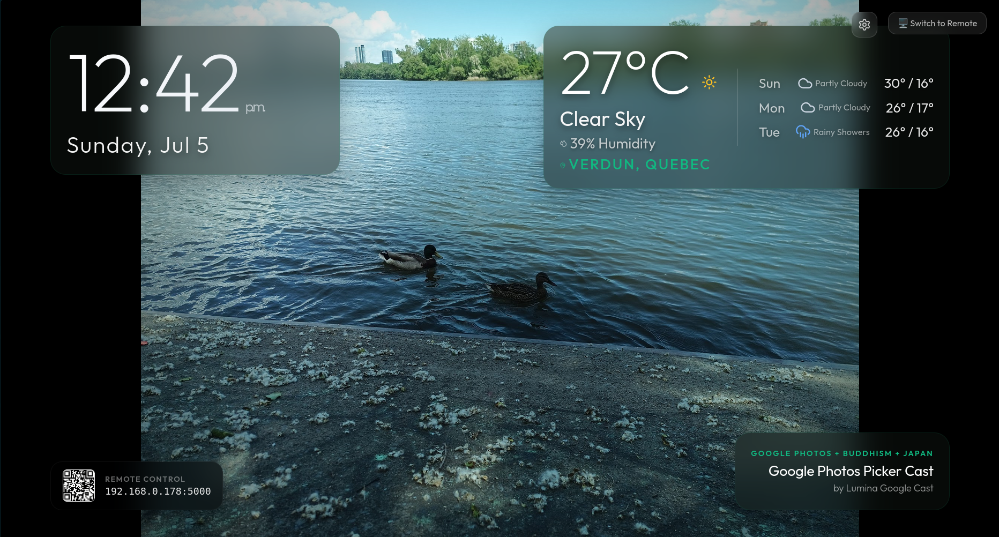
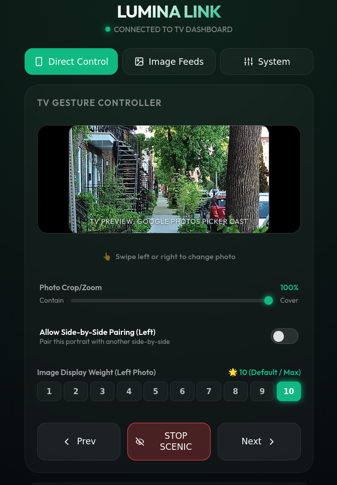

# Lumina

Lumina turns a Linux desktop into a calm, network-aware ambient display: curated images, quiet widgets, weather, local sensor readings, and a phone-friendly remote control for the room.

It is designed for a dedicated HTPC or living-room display running GNOME/Mutter. The project is deliberately local-first: one Node.js daemon owns durable state and system integration, while a React client provides the TV and remote experiences.

<table>
  <tr>
    <td align="center" valign="top">
      <strong>TV dashboard</strong><br />
      
    </td>
    <td align="center" valign="top">
      <strong>Mobile remote</strong><br />
      
    </td>
  </tr>
</table>

## What it does

- **Ambient TV view** — cross-faded wallpapers, clock and weather widgets, optional bokeh, atmospheric overlays, themes, crop controls, and portrait split-screen presentation.
- **Remote control** — a responsive mobile UI for categories, pools, ratings, private photo comments, loved photos, feed sources, system settings, screensaver control, and Google Photos.
- **Many image sources** — configurable combinations of Reddit, Tumblr, Unsplash, Wallhaven, Lorem Picsum, Bing, NASA APOD, the Metropolitan Museum of Art, the Art Institute of Chicago, and AI-oriented sources. Provider availability and credentials vary by feed.
- **Mood-aware selection** — Open-Meteo weather and Google News RSS sentiment can influence the visual atmosphere. Manual location settings are supported, with an optional IP-geolocation fallback.
- **Local environment telemetry** — an Ecowitt-compatible LAN HTTP adapter reads indoor temperature, humidity, and pressure; hourly readings can be retained in SQLite and exported for analysis.
- **Curation tools** — rate or ban images, keep loved images in the collection, edit crops, exclude keywords, configure pools and schedules, and optionally run background vision analysis.
- **Desktop integration** — a GNOME/Mutter idle monitor launches the Chromium kiosk after inactivity, while PulseAudio/PipeWire activity prevents interruption during playback.
- **Resilient slideshow behavior** — the TV preloads the next frame through one authoritative path, retries transient media failures at 1, 2, 4, and 8 seconds, and holds the current image when its host is unreachable.

Lumina keeps the browser’s slideshow bounded to at most two slide elements. That is a memory-conscious design constraint, not a promise of a fixed whole-process RAM footprint; Chromium, GPU drivers, image dimensions, and enabled effects still matter.

## Architecture at a glance

See the [C4 context, container and current/target component views](docs/architecture/README.md).
They are generated from one Structurizr model. The deployment stays one daemon
with the existing browser UI and local stores; proposed internal improvements
are not an additional runtime or a completed refactor.


The control surface is REST-first for durable mutations. Socket.IO remains the live-sync and progress channel, with compatibility handlers retained during the migration. The client keeps snapshot normalization at one boundary so TV and remote views consume the same state shape.

## Runtime requirements

Lumina targets a Linux desktop session with:

- The Node.js version declared in [`.nvmrc`](.nvmrc); supported launchers validate this pin
- Chromium or a Chromium-compatible kiosk binary
- GNOME/Mutter session utilities: `busctl` and a working user D-Bus session
- PulseAudio or PipeWire’s `pactl` command for the media-playback guard
- A display session available to the logged-in user when kiosk mode is enabled

The server listens on port `5000` by default and serves the production client from `client/dist`. The idle daemon uses a 10-minute inactivity threshold by default. The development client uses Vite on port `5173` and routes API/socket traffic to the server.

## Quick start

```bash
git clone https://github.com/esaul314/lumina.git
cd lumina
npm run install-all
cp config.json.example config.json
cp .env.example .env
```

Edit `config.json` for local, non-secret settings such as the port, location, Ecowitt gateway, units, and sensor-history retention. Put credentials and API tokens in `.env`; both files are ignored by Git.

Start the development server and Vite client:

```bash
npm run dev
```

Open one of these views:

| View | URL |
| --- | --- |
| TV dashboard | <http://localhost:5173/?mode=tv> |
| Remote control | <http://localhost:5173/?mode=remote> |

Without `mode`, Lumina chooses a view from the viewport and user agent. A desktop-sized browser defaults to the TV view; a small or mobile browser defaults to the remote.

## Production deployment

Build the client before starting the daemon:

```bash
npm --prefix client run build
./launch.sh
```

The launcher starts the Node server and refuses to create a duplicate instance when port `5000` is already owned. The production URLs are:

- TV: <http://localhost:5000/?mode=tv>
- Remote: <http://localhost:5000/?mode=remote>

For a persistent desktop installation, use the user service installer. It derives the current user, home directory, Node path, D-Bus address, and runtime directory instead of requiring a hand-edited unit:

```bash
./scripts/install-systemd-user-service.sh
loginctl enable-linger "$(id -un)"   # optional: start the user service without an active login
```

Useful diagnostics:

```bash
systemctl --user status lumina
systemctl --user restart lumina
journalctl --user -u lumina -n 100 --no-pager
```

## Configuration and integrations

### Image feeds

The remote’s **Image Feeds** workspace manages categories, keywords, source toggles, pool retention, and scheduled activation. The built-in categories are Scenic Nature, Cosmic Space, Abstract Art, Liminal Spaces, and AI Creations, but pools are extensible.

Pool lifecycle values are prospective guidance, not an immediate cleanup command.
Age expiry runs on later crawls. The crawl size target can be exceeded by loved
photos, retained curated entries and existing oversized pools; a capped ordinary
crawl is published only on growth. Missing/invalid acquisition dates skip age
expiry, not size capping. Google Photos also applies policy on cache-feed
reconstruction and sync/import, so its visible feed can change after saving
without deleting its cache. Daily local-time activation takes effect independently
of crawls. Fields autosave on blur; each pool shows pending, saved or error status.
Errors retain the draft and offer retry (memory may already have changed); newer
edits are never replaced by older acknowledgements. Drafts last for the mounted
Image Feeds editor, not a reload or tab switch. Pool-policy acknowledgements
await persistence and report disk failure; identical policy retries attempt disk
again. Other collection commands and background saves retain their existing
best-effort behavior; their acknowledgements do not guarantee durability. Socket
listener failures are contained and logged, not acknowledged as successful. No persistence schema or rollback-reader change is introduced.


Some integrations are keyless; others are optional:

| Environment variable | Used for |
| --- | --- |
| `NASA_API_KEY` | NASA Astronomy Picture of the Day; the example uses `DEMO_KEY` |
| `USEAPI_TOKEN` | Optional UseAPI/Midjourney source for AI Creations |
| `TUMBLR_API_KEY` | Optional Tumblr tagged-search source |
| `GOOGLE_CLIENT_ID`, `GOOGLE_CLIENT_SECRET` | Google Photos OAuth setup |
| `GOOGLE_REDIRECT_URI` | Trusted absolute HTTPS callback URL (loopback HTTP is allowed for development), ending in `/api/auth/google/callback` |

Feeds are network-dependent and can be rate-limited or unavailable. A failed provider should reduce that provider’s contribution, not invalidate the local collection.
Review each provider’s terms, rate limits, attribution requirements, and image licensing before enabling a feed for anything beyond personal use.

### Private photo comments

In **Remote → Direct Control**, select the image (left/right for a portrait pair)
and use **Private photo comment** beside its rating. Read, create, edit, save or
clear plain text independently of ratings, loved status, captions and AI text.
Comments are not included in normal REST photo/state responses or Socket/TV
snapshots. Available from **1.1.0**; refresh an already-open admin page to load
the new editor.

`GET /api/admin/photo-comment?url=<encoded-current-photo-url>` returns
`{key, comment}`. `PATCH /api/admin/photo-comment` takes `{url, comment}` and returns
`{success: true, key, comment}` only after persistence completes. Text must be a
string of at most 2,000 UTF-16 code units before trimming; empty text clears.
Missing/invalid input is 400, an unknown current URL 404, missing comment adapters 503
(the shared route retains 501 for a missing dispatcher), and storage failure 500.
Failed reads do not enable blind edits; failed saves/clears retain the draft for
retry. Selection changes keep separate drafts; reloading or leaving Direct Control
loses unsaved drafts. Saved entries are cached only for the open tab lifetime;
this is not live multi-client synchronization or conflict detection. Concurrent
accepted writes are last-writer-wins.

A private, versioned `privatePhotoComments` section in `curated_collections.json`
keeps one comment per identity across pools. Google proxy media IDs survive
render/signed-URL refresh; other images use exact stored URLs. Changed public URLs
are new identities. Normal saves, crawl updates and startup dedup retain comments;
removed photos' annotations are retained without destructive pruning, but the API
only exposes currently known curated/external photo URLs, not arbitrary previews
or guessed aliases. Corrupt/unsupported private documents refuse edits. All
collection-file replacements use the same temporary-write/rename boundary;
ordinary write/rename failure preserves the original, without promising power-loss
transactions or multi-process locking. Include this existing file in backups.

Before rolling back to an older collection writer, stop the writer and back up
LATEST data plus a validated, separately protected private comment section.
Pre-1.1.0 writers discard this section on save. Before returning forward, stop the
legacy writer and atomically merge protected comments into the LATEST document,
preserving newer ratings/settings and refusing conflicting newer comments.
Never restore an older whole collection file over newer curation. Release 1.1.0
qualifies this handoff with the actual previous codec in disposable files;
it is not a live downgrade or off-host recovery guarantee.

“Private” means local curation metadata excluded from shared snapshots, not
new authentication, encryption or network-access control. Existing trusted-local
admin access remains the boundary. Do not expose this API as a public service.

### Photo curation (released in 1.1.1)

The selected [curation milestone](./ROADMAP.md#selected-milestone-honest-low-friction-photo-curation--2026-11-26)
adds one shared rating control to Direct Control and the Independent Rating Deck.
Missing/new scores are `null` and display **Unrated**, with no numeric button
selected; **Reset to unrated** explicitly clears a score. Both `PATCH /api/photos`
and compatibility `POST /api/photos/rate` accept `{url, rating: null}`. Missing or
invalid scores retain existing rejection behavior. Existing numeric scores,
including legacy10, are not reclassified: their human/default provenance is unknown.
Unrated playback still uses the current effective weight10. Rating1 remains a ban;
resetting a broken photo does not make it eligible again. Manual/daily crawl,
Google refresh and normal file reconstruction preserve the distinction.

Comments default to a compact **Add comment** or **View/edit comment** disclosure.
Saved, unsaved, loading and error cues remain outside the folded editor; keyboard
or pointer folding never saves, clears or discards text. Per-photo drafts and
expansion survive left/right selection while Direct Control stays open, but not
reloads/tab exit. Portrait rating/reset controls affect only the selected side.
The curation card is qualified at320px and desktop widths with44px-high rating
and disclosure targets. The existing trusted-local privacy/access boundary,
last-writer-wins behavior and private-comment API/identity limits above remain.
Released in1.1.1; refresh an already-open admin page to load the new controls.

### Ecowitt-compatible sensors

In **Remote → System → Environment**, add an Ecowitt-compatible LAN gateway and select the active source. Lumina polls one active profile at a time through `GET /get_livedata_info`, normalizes canonical metric values, and keeps the configured display units separate from storage.

The adapter boundary currently covers temperature, humidity, pressure, and the raw gateway payload. Compatibility includes GW1100, GW1200, GW2000, GW3000, and compatible consoles that expose the generic LAN API. Check the [official Ecowitt HTTP API protocol](https://oss.ecowitt.net/uploads/20260109/HTTP%20API%20interface%20Protocol%20%28Generic%29-%28V1.0.5-2025-10-08%29.pdf) for device-specific payload support.

### Weather and location

Lumina uses Open-Meteo for outdoor conditions and daily forecasts. Explicit manual
location selection takes priority and bypasses IP lookup. Otherwise automatic
location makes one server-side HTTPS request to `https://ipwho.is/`, with a
three-second deadline covering both the request and JSON body. Failed, denied,
rate-limited, timed-out or incomplete responses use the configured `location`
from `config.json`, without borrowing labels from a different location.

Automatic lookup exposes the server's public egress IP to the provider and gives
an approximate location, which can reflect a VPN or ISP rather than the display.
Use manual selection to avoid that IP-lookup request. The provider's
[documented free endpoint](https://ipwhois.io/documentation) needs no API key,
permits commercial use and allows 1,000 requests/day per client IP, with no uptime
SLA (terms checked November 2026). Availability and quota remain external limits;
there is no retry loop. Manual selection bypasses IP lookup, not the subsequent
Open-Meteo forecast request. Forecasts use one five-second deadline covering
headers and JSON body, with owned cancellation/cleanup and no retries. HTTP,
transport, JSON, timeout and invalid current-observation failures do not replace
valid cached weather or physical state and do not broadcast a successful refresh.
A cold `GET /api/weather` returns HTTP 500 on failure without caching it; the next
existing request/refresh can recover. Current temperature and weather code must
be finite numbers; other forecast fields and unknown numeric WMO codes preserve
their existing behavior.

Location edits invalidate the weather cache before refreshing; results for an
obsolete location selection cannot repopulate it. Last-known physical alignment
remains until a successful refresh (it is not a new-location measurement). There
is no TTL/stale indicator or general latest-request policy; requests for the same
selection may still overlap. Weather and time-of-day alignment are independently
configurable from the remote.

### Google Photos

Local cached media accepts only nonempty opaque IDs made of ASCII letters,
digits, `_` and `-`; it never coerces, trims or decodes a service input. Valid
IDs keep their existing `<id>.jpg` names. The HTTP router's normal single URL
decoding is followed by the same validation; encoded/double-encoded path
vocabulary is rejected, not treated as an alternate identity.

Cache I/O rejects observed media-root symlinks and symlink/non-regular/multiply
linked files. Reads and writes own no-follow, nonblocking descriptors and validate
the opened file before reading or truncating; writes recheck after network awaits.
Rejected initial IDs/targets make no provider request; a bad background-download
item is logged without stopping later valid items. Local filesystem failures
remain failures, not a new retry or transactional cache subsystem.

The configured directory ancestry is trusted and must not be concurrently
renamed/replaced by another local writer. These checks are not an openat sandbox
against hostile same-user code, nor new admin authentication. Cache identities,
provider metadata and existing data are not migrated.

The remote can register Google OAuth credentials, complete the local OAuth flow, and use the Google Photos picker. Set `GOOGLE_REDIRECT_URI` in the server environment to the exact trusted absolute HTTPS callback URL registered with the Google OAuth client; HTTP is accepted only for loopback development (`localhost`, `127.0.0.0/8`, or `::1`). It must end in `/api/auth/google/callback`. Lumina never derives that URL from request or forwarded host headers. Each real authorization is bound to the initiating browser with a short-lived, one-time state challenge. The development sandbox callback remains local. Selected media is cached as an external collection and proxied by the server so the TV can display it without exposing provider tokens to the browser.

## REST API surface

The API is intentionally small and inspectable. Examples:

```bash
curl http://localhost:5000/api/state
curl http://localhost:5000/api/photos?category=Scenic%20Nature
curl http://localhost:5000/api/environment
curl http://localhost:5000/api/environment/history/export?format=csv
```

The main routes are:

| Area | Routes |
| --- | --- |
| State and display | `GET /api/state`, `PATCH /api/state`, `POST /api/state/categories`, `POST /api/state/screensaver` |
| Photos | `GET /api/photos`, `PATCH /api/photos`, `POST /api/photos/rate`, `POST /api/photos/next`, `POST /api/photos/prev`, `POST /api/photos/preview` |
| Pools and feeds | `GET /api/pools`, `POST /api/pools`, `PATCH /api/pools/:name`, `DELETE /api/pools/:name`, `GET /api/pools/:name/photos`, `PATCH /api/pools/:name/feed-sources/:source`, `POST /api/pools/:name/crawl`, `POST /api/config/keywords` |
| Background work | `POST /api/jobs/recrawl`, `POST /api/jobs/vision-analysis` |
| Environment | `GET/POST /api/environment/settings`, `GET /api/environment`, `GET /api/environment/adapters`, `GET /api/environment/history`, `GET /api/environment/history/stats`, `GET /api/environment/history/export` |
| Integrations | `GET /api/weather`, `GET /api/config`, admin-secret routes, Google Photos auth and media proxy routes |

Socket.IO broadcasts `state-sync`, photo updates, job status, connection information, and live progress. Durable changes should use REST; sockets are still useful for low-latency UI synchronization and legacy clients.

## Development workflow

Run the baseline checks from the repository root:

```bash
npm test
npm run lint
git diff --check
npm run test:integration
```

For a production-client check:

```bash
npm --prefix client run build
```

The repository’s tests cover domain reducers and selectors, request/response boundaries, feed and sensor behavior, job services, and focused integration smoke paths. See [CONVENTIONS.md](CONVENTIONS.md) for the functional-core/effect-shell style and [AGENTS.md](AGENTS.md) for the operational guide.

## Repository map

```text
client/src/              React TV and remote UI, API adapters, pure state helpers
server/domain/           Functional core: commands, reducers, selectors, contracts
server/runtime/          Idle, kiosk, feed, schedule, and environment runtimes
server/services/         Crawlers and integrations: weather, sensors, vision, Google Photos
server/routes.js         REST route registration and transport decoding
server/sockets.js        Socket.IO live synchronization and compatibility boundary
config.json.example      Non-secret configuration template
.env.example             Secret/integration variable template
ROADMAP.md               Product and platform delivery source of truth
```

## Project status and boundaries

Lumina is an active, evolving personal project. [ROADMAP.md](ROADMAP.md) is the source of truth for product direction; [FUNCTIONAL_REFACTOR_ROADMAP.md](FUNCTIONAL_REFACTOR_ROADMAP.md) tracks the supporting architecture work. Runtime-generated collections, credentials, caches, and sensor history are intentionally local and ignored by Git.

The server is designed for a trusted home LAN and currently enables broad CORS for local control. Do not expose it directly to the public Internet without adding authentication, access controls, and an appropriate reverse-proxy boundary.

This repository does not currently include a checked-in `LICENSE` file. Treat reuse and redistribution accordingly until explicit licensing terms are added.
