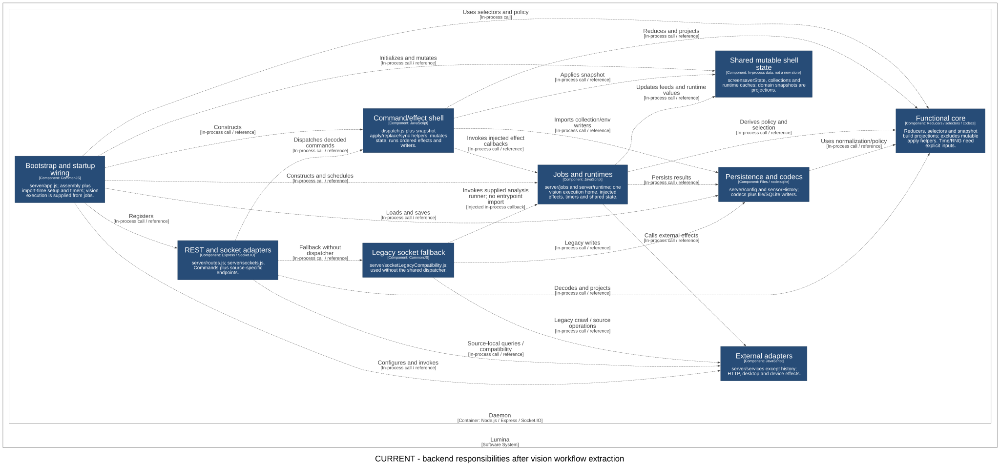
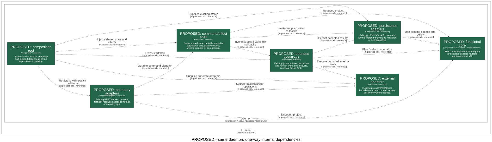

# Lumina architecture: current, target and bridge

This is the architecture decision record, not another roadmap or runtime ledger.
The executable model is [workspace.dsl](workspace.dsl); diagrams below are generated
from that single source. Product priorities remain in [ROADMAP](../../ROADMAP.md);
the ordered bridge and current checkpoint live in the
[engineering companion](../../FUNCTIONAL_REFACTOR_ROADMAP.md#architecture-bridge--2026-11-24).

## Why C4 here

C4 separates context (who/what interacts), containers (running applications/data
stores), and components (responsibilities inside the daemon). A C4 container is
NOT a request for Docker or a new service. Code-level diagrams and one node per
function would obscure the important boundaries; omit them unless a real question
needs that detail. Diagrams expose dependencies, not enforce purity or measure
performance. The import audit found the cycle; the diagram makes its direction
and the intended removal reviewable.

## Read the views

| View | Question answered |
| --- | --- |
| [System context](diagrams/context.svg) | What does Lumina interact with? |
| [Containers](diagrams/containers.svg) | What executes/stores data? The target is unchanged. |
| [Current components](diagrams/current-components.svg) | Where are responsibilities mixed or pointing backwards? |
| [Reference target components](diagrams/target-components.svg) | What should depend on what after bounded simplifications? |





CURRENT describes the source after callback injection, vision extraction, lifecycle and concrete writer injection (AR-1–AR-4); deployed release1.0.2 is unchanged until qualified rollout. The target is a reference responsibility view, not another runtime module queue; AR-1–AR-4 runtime bridge work is accepted at the documented source boundary.
Both component sets share one modeled daemon to make responsibility views comparable;
they do not represent two concurrent backends. The container view is unchanged.
Arrows describe runtime use/dependency, including injected callbacks; they are not
all static imports. AR-1 removes the fallback static back-reference; AR-2 supplies its callback from the existing vision-job module.
Views deliberately omit some startup wiring/read-model details for readability.

The TV and admin/remote are roles of ONE React bundle in different browsers.
Browser-local timers, preload state and UI drafts are not duplicate durable domain
stores. JSON and SQLite are existing file stores, not database-server processes.
The development control plane (orchestrator, task tracker and command node) is
outside Lumina's runtime: Beads is not an application dependency or state owner.

## Source-grounded observations

Import-scan baseline: documentation HEAD 897783c, before the subsequent documentation-only Spotlight commit; deployed application release 1.0.2.
A literal-runtime-import scan with the already installed TypeScript AST covers
91 application JS/JSX files and 169 relative edges. JSDoc imports are excluded.
The audit found one strongly connected set: `app.js -> sockets.js -> socketLegacyCompatibility.js -> app.js`. AR-1 replaces the last static require with a real analysis callback supplied through existing socket configuration. The lower layer no longer imports the entrypoint; fallback behavior and dispatcher bypass remain covered. Injected callback use remains visible in the model; AR-2 moves execution to the existing vision-job boundary. Static acyclicity is not a claim that every runtime callback points in one direction.

| Responsibility | Actual source and important qualification |
| --- | --- |
| Composition and startup | `server.js`, `server/app.js`: app imports 32 relative application modules; bare import defers app dependencies; createApplication assembles snapshot/state/adapters. Idempotent startServer acquires resources; retryable stopServer disposes timers/pollers/history/transport/tracked kiosk, and the native entrypoint owns process signals. |
| Transport | `server/routes.js`, `server/sockets.js`: durable command adapters plus deliberate source-local read/auth/media and telemetry endpoints. |
| Compatibility | `server/socketLegacyCompatibility.js`: durable fallback when dispatcher is absent; receives the real analysis callback from composition, without importing app. Not dead code. |
| Command/effect shell | `server/domain/dispatch.js` plus `snapshot.js` helpers `replaceCollections`, `applyDomainState`, `syncLegacySnapshot`: mutate caller-owned collections/legacy state, run ordered effects and emit events. Dispatch receives concrete collection/env writers through existing dependencies; it still mutates, awaits effects and emits. No direct I/O import does NOT make these helpers pure. |
| Functional core | Reducers, selectors, deterministic policy/codecs and `snapshot.js` projections `buildDomainState`/`buildSnapshot`, NOT its mutable application helpers. Non-dispatch domain imports stay in domain/utilities; that is an import observation, not a purity proof. Time/RNG defaults and caller callbacks require explicit deterministic inputs. |
| Workflows | `server/jobs`, `server/runtime`: existing jobs, refresh, idle/kiosk and schedules; image-analysis execution now has one home in jobs/visionAnalysis, with concrete effects supplied by app. |
| External adapters | `server/services` excluding history: network/device/desktop effects. Crawler failure policy currently bounds only Unsplash/Reddit. |
| Persistence | `server/config` codecs/writers (excluding the state singleton), `server/services/sensorHistory.js`, Google Photos source cache. Keep source-specific formats and atomic merge semantics. |
| State owner | Existing shell-owned state/collections and necessary runtime caches. Domain snapshots and client snapshots are projections, not new authoritative stores. |
| Client boundary | `App.jsx` normalizes live snapshots; API/hooks interpret requests; `client/src/state` literal imports stay within that directory. |

Audit-baseline application sizes (physical lines, including comments/types; not a current-state mirror):
reducer 1,794; Google Photos 1,459; Image Feeds tab 1,294; crawler 1,249;
Dashboard 1,235; routes 1,012; app 742. Size guides review, not mandatory splitting.
The existing scanner's 13,393-line largest-file flag is the test runner.
Its 22 state-path references include fixtures/pure modules, not 22 demonstrated
shadow ledgers; its Python-only control-flow score does not analyze JavaScript.

The app module now imports without loading adapters, opening history or scheduling resources. Explicit construction is still effectful: config/environment reads, snapshot normalization and source-adapter directory creation are deferred, not called pure. One lazy default facade preserves existing callers; separate factories are not qualified multi-instance hosting. Startup owns history/polling/listening. Stop attempts all owned teardown, joins concurrent calls and permits cleanup retries after errors. Disposal is terminal per constructed instance; a fresh constructor/native process is simpler than an in-process Socket.IO reattachment layer. Small in-memory handle sets/generation tokens prevent stale work; they are not persistent runtime ledgers. Previously dispatched adapter effects are not transactionally cancelled/rolled back; the native process/unit owns final interruption.

Concrete persistence is now supplied by composition, not hidden dispatcher imports. Writers/thenables finish before flags/later effects/events; callers await completed dispatch rather than rely on mid-flight microtiming. The dispatcher and snapshot application helpers remain effectful shells despite their domain paths and bounded import dependencies.

Static acyclicity alone is insufficient: injected callbacks, mutation, ambient
time/randomness and import-time effects require behavior tests and inspection.
Do not advertise the entire domain directory or snapshot module as pure. Review initially caught that false mapping: no I/O imports does not exclude mutation. Correct the conceptual boundary without inventing a module solely to make the picture cleaner.

## Target decision

Keep a modular monolith with a functional core and an explicit effect shell:

- ONE daemon, native service, authoritative shell state and existing storage.
- A composition root supplies concrete dependencies and explicitly starts/stops
  owned resources. Lower layers never load the entrypoint.
- Transport adapters decode/dispatch/present; retain deliberate source-specific
  boundary operations, not a forced command for every read.
- Reducers/selectors/codecs calculate; the existing shell interprets ordered
  effects. Inject concrete persistence callbacks when that removes real test/I/O
  coupling; no DI container, universal repository or pass-through wrapper.
- Existing jobs/runtimes own bounded workflows. Reuse the tested source request
  policy as affected providers are repaired; keep failure facts run-local.
- Client normalization and transient presentation effects retain their current
  owners. No second client state manager or server-shaped UI domain.
- Tests enforce one touched boundary at a time through the existing entrypoint.
  Move coherent bodies when it reduces navigation burden, not to meet file quotas.

Rejected now: microservices, a message broker/event bus, event sourcing, a generic
plugin/effect algebra, full TypeScript rewrite, new task synchronizer or automatic
diagram service. These add costs without evidence of a corresponding need.
A file move alone is not a simplification. Do not rename dispatch merely to make
the directory tree look pure; document the exception until a real change pays for
the move. Keep useful compatibility until measured callers/tests justify retiring it.

The bridge has bounded acceptance/removal criteria in the engineering companion.
It preserves existing product priorities, reported physical-TV limits and explicit
security/provider/strict-type debt. This audit does not silently commission those
implementation steps or claim that they are complete.

## Maintain and validate without another service

Edit only workspace.dsl for modeled boundaries. Regenerate these SVGs in the same
commit when responsibilities or dependencies change; don't redraw them manually.
Update current and target views when a bridge slice is accepted. Routine leaf
features that do not change a boundary need no new diagram or history entry.
Keep this README as the rationale/source map; the companion owns task ordering.

Validated with official Structurizr CLI 2025.11.09 (Java model 5.0.2), existing
Java 25 and Graphviz 15.1.1. The release asset's published SHA-256 was verified;
tool staging was disposable, not added to application dependencies. CLI export is
local; no source/model is submitted to a diagram hosting service.

From the repository root, using an already available Structurizr CLI and Graphviz:

```sh
structurizr.sh validate -workspace docs/architecture/workspace.dsl
structurizr.sh export -workspace docs/architecture/workspace.dsl -format dot -output "$ARCH_OUTPUT"
# For each generated structurizr-<view>.dot:
dot -Tsvg "$ARCH_OUTPUT/structurizr-context.dot" -o docs/architecture/diagrams/context.svg
```

ARCH_OUTPUT is a disposable directory, not another source checkout. Repeat the
last command for containers, current-components and target-components. The DSL
has no remote includes, plugins, scripts or hosted themes. Rendered exports are
read-only derivatives. Parser validity does not replace source-map review.
